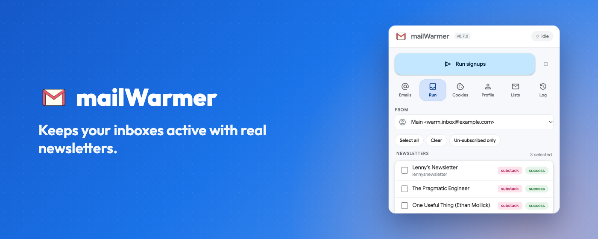
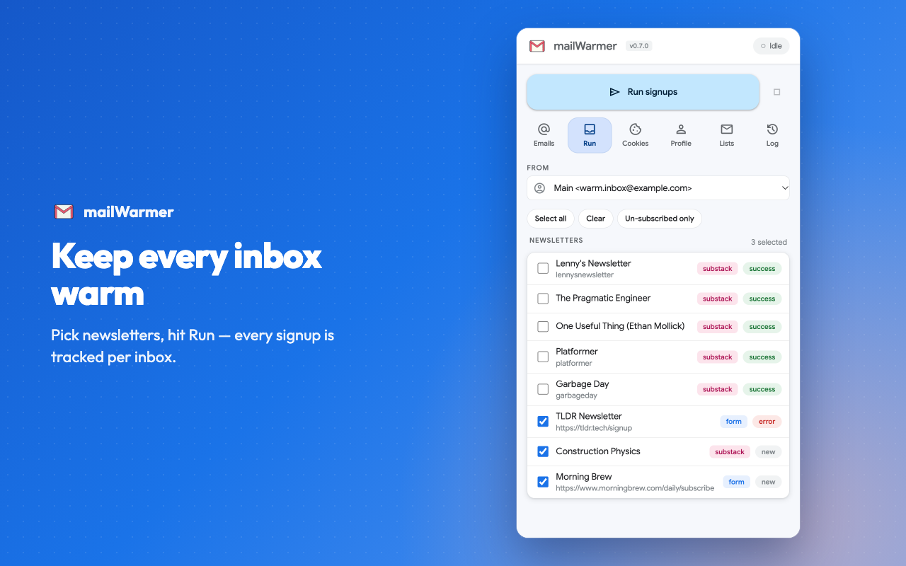
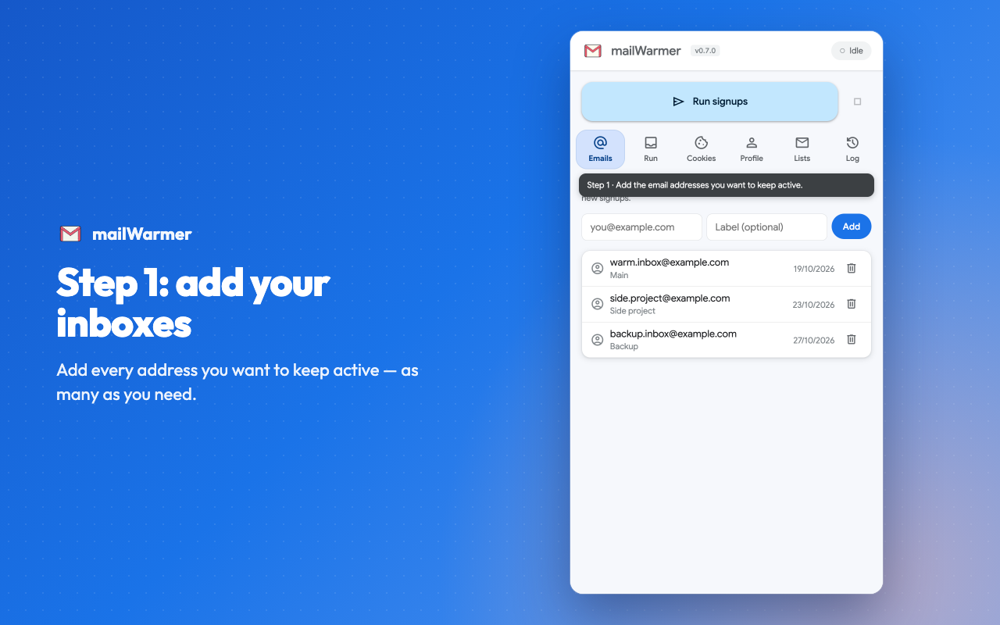
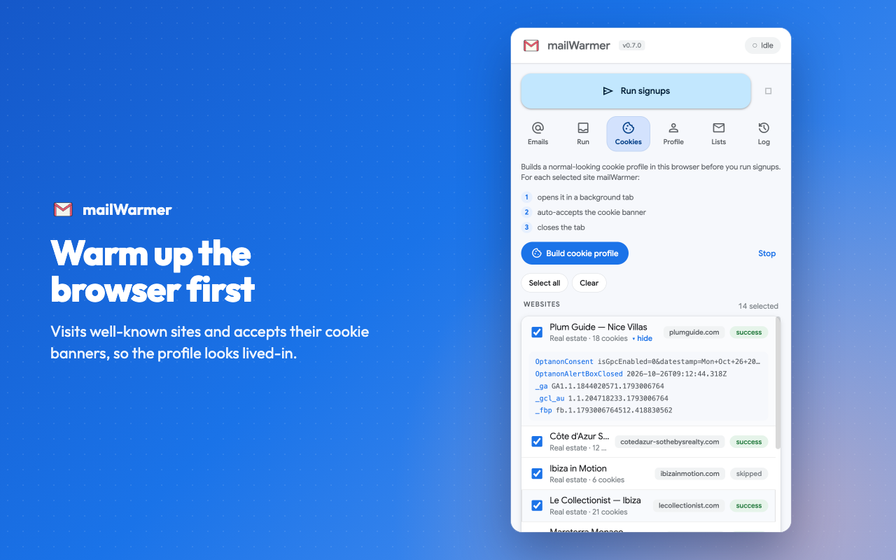
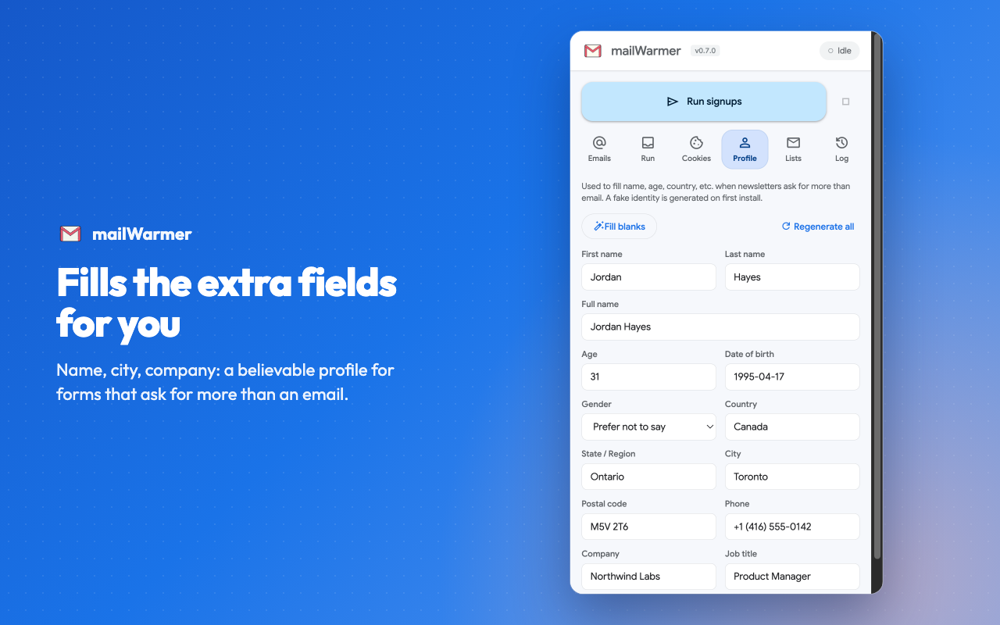
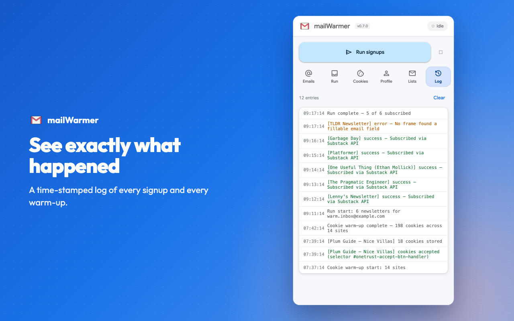
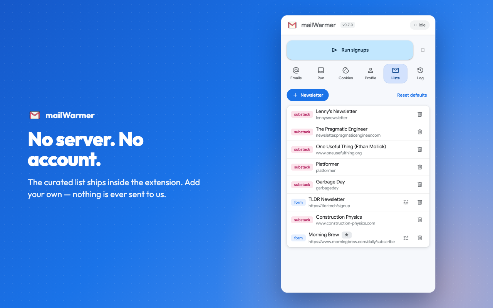

<div align="center">


# mailWarmer

**Keep every inbox warm.** A free Chrome extension that subscribes your email addresses to real,
hand-picked newsletters, so fresh inboxes keep receiving mail and read as active, trusted accounts.

[](https://chromewebstore.google.com/detail/mail-warmer/ikibedkcbfcilgignjobgdlioninmige)
[](https://chromewebstore.google.com/detail/mail-warmer/ikibedkcbfcilgignjobgdlioninmige)


[**Install**](https://chromewebstore.google.com/detail/mail-warmer/ikibedkcbfcilgignjobgdlioninmige) ·
[Website](https://mailwarmer.rheav.dev) ·
[Docs](https://mailwarmer.rheav.dev/docs) ·
[Documentação em português](https://mailwarmer.rheav.dev/pt-br/docs) ·
[Changelog](https://mailwarmer.rheav.dev/changelog)

<br />



</div>

---

## Why inboxes go cold

You create a fresh address for a new project, a client, or a side account. Then it sits there.

| | |
| --- | --- |
| **Day 0** | You spin up a fresh inbox for a new project. |
| **Day 9** | It sits empty. No mail in, no mail out. |
| **Day 21** | Providers start flagging it as dormant. |
| **Day 34** | You use it to sign up somewhere — and get blocked. |
| **Day 48** | The account gets limited, then quietly suspended. |

Email providers trust accounts that look used. A silent inbox looks abandoned, and abandoned
accounts get rate-limited, locked, or refused by the services you try to sign up for: social
networks, affiliate programs, new tools.

**mailWarmer fixes the silence.** It subscribes your addresses to quality newsletters, one at a
time, at a human pace. Real mail starts arriving on its own schedule, and the inbox reads as a
living account — ready when you need it.

## What it does

<table>
<tr>
<td width="33%" valign="top">

### 📬 Subscribes at a human pace
Pick an address and some newsletters, click **Run signups**. mailWarmer goes through them one by
one, a few seconds apart, and tracks the result of every email × newsletter.

</td>
<td width="33%" valign="top">

### 🍪 Warms up the browser
Optional: before signing up, it visits well-known sites in the background and accepts their
cookie banners, so a brand-new browser profile looks lived-in.

</td>
<td width="33%" valign="top">

### 🔒 Keeps everything local
No server, no account, no analytics. Your addresses, profile and history never leave your
browser. The newsletter list ships inside the extension.

</td>
</tr>
</table>

## A look inside

Everything happens in one side panel, next to the page you are on.

<table>
<tr>
<td width="50%"></td>
<td width="50%"></td>
</tr>
<tr>
<td width="50%"></td>
<td width="50%"></td>
</tr>
<tr>
<td width="50%"></td>
<td width="50%"></td>
</tr>
</table>

| Tab | What it is for |
| --- | --- |
| **Emails** · step 1 | The addresses you want to keep active, each with an optional label. |
| **Run** · step 2 | Choose an address and newsletters, run the signups, watch each status change. |
| **Cookies** · optional | One-click warm-up that builds a normal-looking cookie profile. |
| **Profile** · optional | Name, city, company… typed in when a form asks for more than an email. A fictional identity is generated on install. |
| **Lists** · optional | The curated newsletters, plus your own — Substack publications or any signup page. |
| **Log** | What happened in every signup and warm-up, with the reason when something fails. |

## Get started in two minutes

1. **Install** mailWarmer from the [Chrome Web Store](https://chromewebstore.google.com/detail/mail-warmer/ikibedkcbfcilgignjobgdlioninmige).
   It works in Chrome, Edge, Brave and other Chromium browsers on desktop.
2. **Pin it** (puzzle-piece icon → pin) and click the icon to open the side panel.
3. **Emails** tab: add the addresses you want to keep warm.
4. **Run** tab: choose an address in **From**, tick newsletters, click **Run signups**.
5. **Open the inbox** and click any "Confirm your subscription" emails. mailWarmer never reads
   your inbox, so that click is yours.

Within a day or two the newsletters start arriving. The
[step-by-step guide](https://mailwarmer.rheav.dev/docs) has screenshots of every tab, and
[Troubleshooting](https://mailwarmer.rheav.dev/docs/troubleshooting) explains every error message.

## Private by design

mailWarmer has **no server**. It is not a policy promise — it is enforced in code:

- No analytics, no tracking, no install ID, no remote configuration.
- The curated newsletter list is a file inside the extension (`extension/newsletters.json`) and
  changes only when the extension updates.
- The only requests it makes are the ones you start: signups to each newsletter's own website,
  and the cookie warm-up visits.
- It never signs in to, opens, or reads your inbox.
- [`scripts/preflight.mjs`](scripts/preflight.mjs) runs before every build and **fails it** if the
  extension gains any network call of its own.

Your data lives in `chrome.storage.local`. Remove the extension and it is gone. Full details in
the [Privacy Policy](https://mailwarmer.rheav.dev/privacy).

## Use it responsibly

mailWarmer subscribes you to legitimate newsletters that you choose, at the pace of a person
signing up by hand. Use it only with addresses you own or are allowed to use, and respect the
terms of the newsletters you join. See the [Terms](https://mailwarmer.rheav.dev/terms).

## Languages

The extension and the website speak **English** and **Português (Brasil)**. The extension follows
your browser language; the website has an EN | PT switch.

---

## For developers

The extension is plain Manifest V3 with ES modules — no bundler, no framework, no runtime
dependencies. The `extension/` folder *is* the extension.

```sh
npm test            # unit tests (node --test, with a chrome.* stub)
npm run build       # preflight, then release/mailwarmer-<version>.zip
```

Load it: `chrome://extensions` → Developer mode → **Load unpacked** → select `extension/`.

Website (Astro + Tailwind): `cd website && npm install && npm run dev`.

### Repository layout

```
extension/                 The extension (load this folder unpacked)
├── manifest.json
├── _locales/{en,pt_BR}/   UI strings (lib/i18n.js)
├── newsletters.json       The curated newsletter list
├── background/
│   ├── index.js           Service worker: install/update, message router
│   ├── runner.js          Signup run loop + progress
│   ├── cookie-warmer.js   Cookie warm-up loop
│   └── adapters/
│       ├── substack.js    Substack public signup endpoint
│       └── form.js        Generic form (opens tab, injects form-filler)
├── content/form-filler.js Finds the email field, skips honeypots, submits
├── lib/                   storage, i18n, wait helpers, badge, fake profile,
│                          cookie-site list, message constants
├── sidepanel/             sidepanel.html/.css + one module per tab
│                          (run, cookies, emails, profile, lists, log) + ui.js
└── public/                logo.png, self-hosted fonts
scripts/preflight.mjs      Build guard (network, version, translations)
tests/                     node --test unit tests (chrome.* stub)
docs/store/                Store listing, screenshots and the tools that make them
website/                   Astro site: landing, docs, changelog, legal (en + pt-br)
server/                    Old newsletter API — not used by the extension
```

### How a run works

1. Pick an email and newsletters on the **Run** tab, hit **Run signups**.
2. `background/runner.js` takes them one at a time, 2.5–5.5 s apart:
   - **substack** → `POST https://<host>/api/v1/free` with the email;
   - **form** → opens the signup URL in a background tab, injects
     `content/form-filler.js` into every frame, fills the email (and any
     profile fields the form asks for) and submits.
3. Each result lands in `history` per email + newsletter, the **Log** tab and
   the toolbar badge (orange while running, then green successes or red errors).

### Cookie warm-up

For each selected site mailWarmer opens it in a background tab, scrolls and
clicks the page body to nudge lazy consent banners, accepts the banner (known
consent-platform selectors first — OneTrust, Cookiebot, Didomi, Usercentrics,
Osano, CookieYes, Complianz, tarteaucitron, Axeptio, Iubenda… — then a short
accept-text fallback), closes the tab and reads back the cookies the visit
left. The site list is `extension/lib/cookie-sites.js`.

### Translations

`extension/_locales/en` and `pt_BR` hold every string, including log lines
and form-filler reasons. HTML uses `data-i18n`, `data-i18n-placeholder` and
`data-i18n-title`; JS uses `t('key', ...args)` with `$1…$9`. The browser
language picks the locale; a `lang` key in storage (`en` / `pt_BR`)
overrides it — the store screenshots use that. The preflight fails if a key
is missing in either language.

### Newsletter entry format

```jsonc
// Substack by slug — resolves to <slug>.substack.com
{ "name": "Lenny's Newsletter", "type": "substack", "slug": "lennysnewsletter" }

// Substack on a custom domain
{ "name": "Slow Boring", "type": "substack", "host": "www.slowboring.com" }

// Generic signup form at an arbitrary URL
{ "name": "TLDR Newsletter", "type": "form", "url": "https://tldr.tech/signup" }
```

In storage each entry also gets an `id` and a `source`: `default` (from
`newsletters.json`, re-synced on every extension update, ids kept) or
`custom` (added by the user, never touched).

### Data & storage

Everything lives in `chrome.storage.local` (schema in `lib/storage.js`):
`emails`, `activeEmailId`, `newsletters`, `history`, `log` (capped at 500),
`profile`, `cookieRun`, and optionally `lang`. Nothing leaves the browser
except the signups and warm-up visits the user starts.

### Releases

See [`docs/RELEASE.md`](docs/RELEASE.md) and [`CHANGELOG.md`](CHANGELOG.md).

## Contributing

Found a newsletter that fails, or want to suggest one for the curated list?
[Open an issue](https://github.com/rheav/mail-warmer/issues/new) with its name and signup page —
or a pull request adding it to `extension/newsletters.json`. Please never paste a real email
address in an issue.
